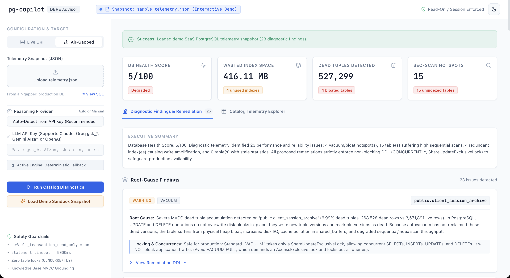
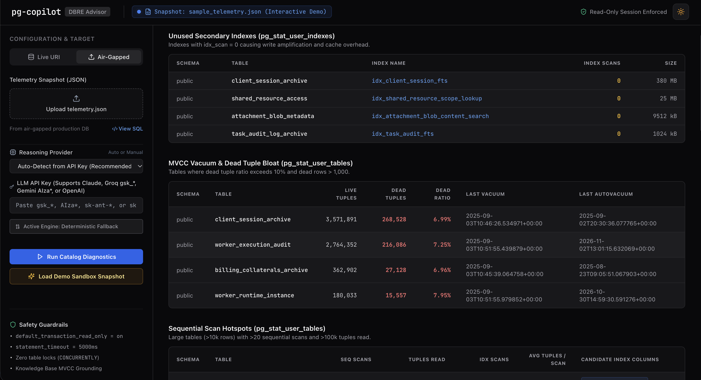

# pg-copilot: AI-Native PostgreSQL Health, Index & Vacuum Advisor

> **Production-Safe, Read-Only PostgreSQL Catalog Observability & AI-Driven Remediation**
>
> 🚀 **Live Demo:** [https://pg-copilot-silk.vercel.app](https://pg-copilot-silk.vercel.app)

[](https://pg-copilot-silk.vercel.app)
[](https://www.python.org/downloads/)
[](https://fastapi.tiangolo.com)
[](https://vitejs.dev/)
[](https://www.postgresql.org/)
[](https://pytest.org/)

`pg-copilot` is an AI-native database reliability engineering (DBRE) advisor built for production PostgreSQL clusters. It non-blockingly inspects PostgreSQL system catalogs (`pg_stat_user_tables`, `pg_stat_user_indexes`, `pg_stats`, and `pg_index`), isolates hidden performance regressions (MVCC dead tuple bloat, sequential scan churn, redundant indexes, and stale optimizer statistics), and synthesizes validated, non-blocking remediation SQL via an LLM DBRE Reasoning Agent grounded in internal PostgreSQL engine mechanics.

---

## 📸 Interface & Live Dashboard

### 1. Executive Health Score & Grounded AI Findings
*Real-time PostgreSQL cluster health score, severity-graded performance findings (Bloat, Missing Indexes, Redundant Indexes, Stale Optimizer Stats), root-cause analysis, and non-blocking SQL remediation.*



### 2. Deep Catalog Telemetry Explorer
*Granular breakdown of system catalog internals: MVCC dead tuple ratios, sequential scan load, write-amplifying unused indexes, and column cardinality metrics.*



---

## 🎯 The Problem

In high-throughput OLTP PostgreSQL systems, performance degradations often compound invisibly within system catalogs long before surfacing as user-facing latency anomalies:

1. **MVCC Dead Tuple Bloat**:
   PostgreSQL Multi-Version Concurrency Control (MVCC) never overwrites rows in-place during `UPDATE` or `DELETE` operations. Instead, it appends new tuple versions and marks obsolete rows as dead. If autovacuum scale factors are misconfigured or fail to keep pace with write velocity, dead tuples accumulate, causing physical heap bloat, shared buffer cache churn, and degraded sequential and index scan throughput.
2. **Write Amplification from Redundant Indexes**:
   Every secondary B-tree index on a table must be maintained during every `INSERT`, `DELETE`, and non-HOT `UPDATE`. Unused indexes (`idx_scan = 0`) waste operating system RAM and disk I/O while producing pure write amplification and write stalls.
3. **Sequential Scan Churn on Unindexed Predicates**:
   Without selective indexes matching queried filters, the query planner is forced to sweep entire table heaps from storage into `shared_buffers`, saturating CPU and evicting warm pages.
4. **Stale Optimizer Statistics**:
   The cost-based optimizer (CBO) relies on `pg_statistic` histogram and Most Common Values (MCV) distributions. Heavy row modifications without updated statistics cause catastrophic plan regressions—such as choosing slow Nested Loop joins over Hash Joins or ignoring viable indexes.

---

## 🏗️ System Architecture

```
┌─────────────────────────────────────────────────────────────────────────────┐
│                       Frontend: React + Vite + Tailwind                     │
│        (KPI Grid • Severity Badges • Telemetry Explorer • SQL Exporter)     │
│                                                                             │
│   [Mode A: Live Connection URI]       [Mode B: Air-Gapped JSON Snapshot]    │
└──────────────────────┬───────────────────────────────────────┬──────────────┘
                       │                                       │
                       ▼                                       ▼
┌──────────────────────────────────────────────┐ ┌────────────────────────────┐
│ Safe Read-Only Catalog Inspector (analyzer/) │ │ Air-Gapped Snapshot Loader │
│                                              │ │ (Offline telemetry.json)   │
│  • default_transaction_read_only = on        │ └─────────────┬──────────────┘
│  • statement_timeout = 5000ms                │               │
│  • pg_stat_user_tables / indexes telemetry   │               │
│  • pg_stats unindexed cardinality filter     │               │
└──────────────────────┬───────────────────────┘               │
                       │                                       │
                       └───────────────────┬───────────────────┘
                                           │ (JSON Telemetry)
                                           ▼
┌─────────────────────────────────────────────────────────────────────────────┐
│                 FastAPI Backend Service (`api/main.py`)                     │
│                                                                             │
│  POST /api/diagnose          --> Live catalog collection + AI diagnosis     │
│  POST /api/diagnose-snapshot --> Air-gapped JSON telemetry diagnosis        │
│  POST /api/reseed            --> Restores degraded benchmark sandbox DB     │
└──────────────────────────────────────┬──────────────────────────────────────┘
                                       │
                                       ▼
┌─────────────────────────────────────────────────────────────────────────────┐
│                      AI Reasoning Agent (agent/)                            │
│                                                                             │
│  ┌───────────────────────────────────────────────────────────────────────┐  │
│  │ Knowledge Base Grounding: kb/postgres_grounding.md                    │  │
│  │ Auto-Detected Providers (Detected via API Key Prefix):                │  │
│  │  • Google Gemini:    AIza*    --> gemini-2.5-flash (404 fallback)     │  │
│  │  • Groq:             gsk_*    --> llama-3.3-70b-versatile             │  │
│  │  • Anthropic Claude: sk-ant-* --> claude-3-5-sonnet-latest (Tool-use) │  │
│  │  • OpenAI:           sk-*     --> gpt-4o-mini                         │  │
│  │  • Deterministic Engine: Zero API key, 100% offline rule engine       │  │
│  └───────────────────────────────────────────────────────────────────────┘  │
│  • Grounded root-cause analysis of internal engine mechanisms                │
│  • Column cardinality sanity checks (filters null_pct >= 90%, n_dist in 0,1)│
│  • Lock-level isolation analysis (ShareUpdateExclusiveLock vs AccessExclusive│
│  • Consolidated, non-blocking remediation script assembly                   │
└──────────────────────────────────────┬──────────────────────────────────────┘
                                       │
                                       ▼
┌─────────────────────────────────────────────────────────────────────────────┐
│                        Non-Blocking Remediation DDL                         │
│                                                                             │
│  • DROP INDEX CONCURRENTLY IF EXISTS ...                                    │
│  • CREATE INDEX CONCURRENTLY IF NOT EXISTS ...                              │
│  • VACUUM (VERBOSE, ANALYZE) ...                                            │
│  • ALTER TABLE ... SET (autovacuum_vacuum_scale_factor = 0.05)               │
└─────────────────────────────────────────────────────────────────────────────┘
```

---

## 🤖 Multi-Provider AI Engine & Key Prefix Auto-Detection

`pg-copilot` supports all major LLM providers out of the box with zero manual configuration. The advisor automatically detects the active provider directly from the API key prefix:

| API Key Prefix | Auto-Detected Engine | Model Target | Protocol / Mode |
| :--- | :--- | :--- | :--- |
| `AIza*` | **Google Gemini** | `gemini-2.5-flash` *(with fallback to `2.0` / `1.5`)* | OpenAI SDK (`json_object`) |
| `gsk_*` | **Groq** | `llama-3.3-70b-versatile` | OpenAI SDK (`json_object`) |
| `sk-ant-*` | **Anthropic Claude** | `claude-3-5-sonnet-latest` | Anthropic SDK (`tool_use`) |
| `sk-*` | **OpenAI** | `gpt-4o-mini` | OpenAI SDK (`json_object`) |
| *(None / Offline)* | **Deterministic Engine** | Local Rule Engine | Offline MVCC Heuristics |

### Graceful Fallback Guarantees
- If any provider encounters authentication errors, rate limits (HTTP 429), or quota exhaustion, `pg-copilot` logs a warning and **gracefully falls back to the deterministic offline engine** while surfacing the root cause in the executive summary.
- The user can also toggle between providers manually or enforce 100% offline deterministic rule evaluation directly from the UI sidebar.

---

## 🛡️ Production Safety & DBRE Guardrails

`pg-copilot` is engineered specifically to ensure that running diagnostics against high-volume databases will **never** destabilize application traffic:

| Guardrail | Implementation | Protection |
| :--- | :--- | :--- |
| **Read-Only Session** | `SET default_transaction_read_only = on;` | Database engine rejects any `INSERT`, `UPDATE`, `DELETE`, `CREATE`, `DROP`, or `ALTER` with `ReadOnlySqlTransaction`. |
| **Strict Query Timeout** | `SET statement_timeout = 5000;` | Cancels any diagnostic query exceeding 5,000ms, preventing lock queues or transaction backlog. |
| **Non-Blocking DDL Enforcement** | Pydantic Schema Validators | Validates that all index drops and creations use `CONCURRENTLY` (`ShareUpdateExclusiveLock`), permitting uninterrupted reads and writes. Blocks blocking `VACUUM FULL` and exclusive index locks. |
| **Cardinality Filtering** | `pg_stats` Cardinality Sanitizer | Skips candidate columns where `null_pct >= 90.0` or single/zero distinct values (`n_distinct in (0, 1)`), preventing index creation on empty or constant columns. |
| **Air-Gapped Snapshot Mode** | Client-Side JSON Upload | Ingests pre-exported `telemetry.json` from isolated VPCs or air-gapped DBs without requiring live inbound network ingress. |
| **Cloud Demo Guardrail** | Hostname Detection | On hosted cloud domains (`window.location.hostname !== 'localhost'`), live database ingress is disabled to prevent accidental connection attempts. |

---

## ⚡ 2-Minute Quickstart

### 1. Launch the Isolated PostgreSQL Sandbox
Start the isolated PostgreSQL 16 container (configured with `autovacuum=off` and `track_counts=on` to model predictable bloat):

```bash
docker compose up -d
```

### 2. Seed Degraded Production Scenarios
Run the seed script to simulate 100k bloated orders, missing indexes with 4.8M sequential reads, redundant indexes, and stale statistics:

```bash
python seed_dirty_db.py
```

### 3. Start the Full-Stack Application

**Terminal 1 — FastAPI Backend**:
```bash
uvicorn api.main:app --reload --port 8000
```

**Terminal 2 — React + Vite Frontend**:
```bash
cd frontend
npm install
npm run dev
```

Open **`http://localhost:5173`** in your browser.

---

## 🌐 Live Interactive Cloud Demo

Experience `pg-copilot` in action directly in your browser with zero setup:

👉 **[https://pg-copilot-silk.vercel.app](https://pg-copilot-silk.vercel.app)**

- **Instant Zero-Config Sandbox**: Automatically renders an interactive scrubbed SaaS cluster snapshot ([`sample_telemetry.json`](sample_telemetry.json)) and pre-computed diagnostic report ([`sample_report.json`](frontend/src/data/sample_report.json)) in **<50ms**.
- **Interactive DBRE Workspace**: Click **"Load Demo Sandbox Snapshot"** to inspect 23 realistic performance findings across bloated tables (`order_item_details`), write-amplifying unused indexes (`client_session_archive`), sequential scan churn, and consolidated non-blocking remediation scripts.
- **Client-Side Air-Gapped Mode**: Upload any offline catalog telemetry JSON directly in the browser to analyze external PostgreSQL clusters without opening network ports.

<details>
<summary><b>🔍 How to Export Your Own <code>telemetry.json</code> for Air-Gapped Analysis</b></summary>
<br>

Run this read-only catalog aggregation query directly in `psql`, pgAdmin, or DBeaver against your PostgreSQL database to generate an air-gapped snapshot compatible with the cloud demo:

```sql
SELECT json_build_object(
    'collected_at', now()::text,
    'unused_indexes', (
        SELECT COALESCE(json_agg(t), '[]'::json) FROM (
            SELECT
                sui.schemaname,
                sui.relname AS table_name,
                sui.indexrelname AS index_name,
                sui.idx_scan,
                pg_relation_size(sui.indexrelid) AS index_size_bytes,
                pg_size_pretty(pg_relation_size(sui.indexrelid)) AS index_size_pretty
            FROM pg_stat_user_indexes sui
            JOIN pg_index i ON sui.indexrelid = i.indexrelid
            WHERE sui.idx_scan = 0
              AND i.indisunique IS FALSE
              AND i.indisprimary IS FALSE
            ORDER BY index_size_bytes DESC
        ) t
    ),
    'vacuum_bloat_candidates', (
        SELECT COALESCE(json_agg(t), '[]'::json) FROM (
            SELECT
                schemaname,
                relname,
                n_live_tup,
                n_dead_tup,
                round(100.0 * n_dead_tup / NULLIF(n_live_tup + n_dead_tup, 0), 2)::float AS dead_tup_ratio,
                last_vacuum::text,
                last_autovacuum::text
            FROM pg_stat_user_tables
            WHERE n_dead_tup > 5000
              AND (100.0 * n_dead_tup / NULLIF(n_live_tup + n_dead_tup, 0)) > 5.0
            ORDER BY dead_tup_ratio DESC
        ) t
    ),
    'missing_index_candidates', (
        SELECT COALESCE(json_agg(t), '[]'::json) FROM (
            SELECT
                schemaname,
                relname,
                seq_scan,
                seq_tup_read,
                idx_scan,
                n_live_tup,
                round(100.0 * seq_scan / NULLIF(seq_scan + COALESCE(idx_scan, 0), 0), 2)::float AS seq_scan_ratio
            FROM pg_stat_user_tables
            WHERE seq_scan > 20
              AND n_live_tup > 10000
              AND seq_tup_read > 100000
            ORDER BY seq_tup_read DESC
        ) t
    ),
    'stale_stats_candidates', (
        SELECT COALESCE(json_agg(t), '[]'::json) FROM (
            SELECT
                schemaname,
                relname,
                n_live_tup,
                n_mod_since_analyze,
                round(100.0 * n_mod_since_analyze / NULLIF(n_live_tup, 0), 2)::float AS mod_ratio,
                last_analyze::text,
                last_autoanalyze::text
            FROM pg_stat_user_tables
            WHERE n_mod_since_analyze > 10000
              AND (100.0 * n_mod_since_analyze / NULLIF(n_live_tup, 0)) > 10.0
            ORDER BY mod_ratio DESC
        ) t
    )
);
```

Or export directly to a file from your terminal:

```bash
psql "$DATABASE_URL" -t -A -q -c "SELECT json_build_object('collected_at', now()::text, ...);" > telemetry.json
```

Then drop `telemetry.json` into the upload zone at [pg-copilot-silk.vercel.app](https://pg-copilot-silk.vercel.app).
</details>

---

## 🧪 Comprehensive Test Suite (30 Tests)

Run the full integration and unit test suite verifying catalog queries, Pydantic DDL validators, provider auto-detection, and API endpoints:

```bash
pytest tests/ -v
```

Output:
```text
tests/test_advisor.py::test_advisor_report_schema_valid PASSED                    [  3%]
tests/test_advisor.py::test_advisor_report_score_bounds PASSED                    [  6%]
tests/test_advisor.py::test_enforce_concurrently_in_index_drop PASSED             [ 10%]
tests/test_advisor.py::test_deterministic_diagnosis_engine PASSED                 [ 13%]
tests/test_advisor.py::test_readonly_connection_session_settings PASSED           [ 16%]
tests/test_advisor.py::test_readonly_connection_rejects_insert PASSED             [ 20%]
tests/test_advisor.py::test_readonly_connection_rejects_update PASSED             [ 23%]
tests/test_advisor.py::test_readonly_connection_rejects_delete PASSED             [ 26%]
tests/test_advisor.py::test_get_unused_indexes_structure PASSED                   [ 30%]
tests/test_advisor.py::test_get_vacuum_bloat_candidates_structure PASSED          [ 33%]
tests/test_advisor.py::test_get_missing_index_candidates_structure PASSED          [ 36%]
tests/test_advisor.py::test_get_stale_stats_candidates_structure PASSED           [ 40%]
tests/test_advisor.py::test_collect_full_telemetry PASSED                         [ 43%]
tests/test_advisor.py::test_air_gapped_telemetry_snapshot_lifecycle PASSED        [ 46%]
tests/test_advisor.py::test_markdown_grounding_kb_injection PASSED                [ 50%]
tests/test_advisor.py::test_anthropic_claude_provider_fallback_flow PASSED        [ 53%]
tests/test_advisor.py::test_missing_index_uses_candidate_columns_case_a PASSED    [ 56%]
tests/test_advisor.py::test_missing_index_legacy_snapshot_template_case_b PASSED  [ 60%]
tests/test_advisor.py::test_consolidated_sql_deduplicates_redundant_analyze PASSED [ 63%]
tests/test_advisor.py::test_filter_telemetry_thresholds_filters_false_positives PASSED [ 66%]
tests/test_advisor.py::test_missing_index_candidate_columns_dict_structure_and_rca PASSED [ 70%]
tests/test_advisor.py::test_candidate_columns_filter_high_nulls_and_low_cardinality PASSED [ 73%]
tests/test_advisor.py::test_detect_provider_from_key PASSED                       [ 76%]
tests/test_advisor.py::test_provider_auto_detection_and_fallback_on_api_error PASSED [ 80%]
tests/test_advisor.py::test_mocked_groq_and_gemini_calls PASSED                   [ 83%]
tests/test_advisor.py::test_clean_api_key PASSED                                  [ 86%]
tests/test_advisor.py::test_gemini_model_fallback_on_404 PASSED                   [ 90%]
tests/test_api.py::test_health_check_endpoint PASSED                              [ 93%]
tests/test_api.py::test_diagnose_snapshot_endpoint PASSED                         [ 96%]
tests/test_api.py::test_diagnose_live_endpoint PASSED                             [100%]

============================== 30 passed in 0.43s ==============================
```

---

## 📂 Project Structure

```
pg-copilot/
├── docker-compose.yml              # PostgreSQL 16 sandbox (track_counts=on, autovacuum=off)
├── seed_dirty_db.py                # Simulates bloat, seq scans, unused indexes & stale stats
├── sample_telemetry.json           # Scrubbed SaaS production catalog telemetry dataset
├── requirements.txt                # Core Python dependencies (FastAPI, uvicorn, pydantic, etc.)
├── .env.example                    # Configuration template
├── docs/
│   └── assets/                     # Dashboard overview and catalog telemetry screenshots
├── kb/
│   └── postgres_grounding.md       # DBRE grounding knowledge base (MVCC, locks, scale factors)
├── api/
│   ├── __init__.py                 # API package
│   └── main.py                     # FastAPI service (/api/diagnose, /api/diagnose-snapshot, /api/reseed)
├── frontend/                       # Standalone React 18 + Vite + Tailwind CSS client
│   ├── package.json
│   ├── vite.config.js
│   ├── tailwind.config.js
│   ├── public/
│   │   └── sample_telemetry.json   # Static asset for instant 1-click cloud demo
│   └── src/
│       ├── data/
│       │   └── sample_report.json  # Pre-computed diagnostic report for Vercel offline demo
│       ├── components/             # Sidebar, Navbar, KpiGrid, FindingCard, RemediationScript, TelemetryTables
│       ├── App.jsx
│       └── main.jsx
├── analyzer/
│   ├── __init__.py                 # Package exports
│   ├── db.py                       # Safe read-only context manager with statement_timeout
│   └── catalog_queries.py          # pg_stat_* catalog collectors & cardinality inspection
├── agent/
│   ├── __init__.py                 # Agent exports
│   └── advisor_agent.py            # Pydantic models, multi-LLM routing, and deterministic engine
└── tests/
    ├── __init__.py
    ├── test_advisor.py             # Unit & integration tests for catalog collectors & advisor engine
    └── test_api.py                 # FastAPI endpoint integration tests
```

---

## 📄 License

MIT License. Open source for DBREs, performance engineers, and developers building on PostgreSQL.
